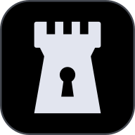

# CypherArx GUI



[English version / 英語版はこちら](README.md)

**CypherArx** のデスクトップ GUI。`cypherarx-core` の上に構築し、
[lamina-ui](https://github.com/Capsicum0907/lamina-ui)（SDL3 ＋ ThorVG の上の Material 3 Expressive）で
描いています。

> **状態: プレアルファ。** ほかの誰のレビューも受けておらず、金庫の形式は予告なく変わる
> ことがあります。**まだ本物のパスワードを入れないでください。**

これはフェーズ 2、CypherArx で最初にユーザーインターフェースを持つ部分です。UI を持たないコアは
`cypherarx-core` にあり、ここには git サブモジュール `external/cypherarx-core` として取り込んで
います。GUI は素の C++ でコアを直接リンクするため、秘密情報が言語境界を越えることはなく、
コアの保護メモリ（`Secret`）をそのまま使えます。

2026 年 11 月までは Dear ImGui 版がここにありました。git の履歴に残っています。

## ツールチェーン

MSVC（Visual Studio 2022）＋ CMake ＋ Ninja ＋ vcpkg（マニフェストモード）。`cypherarx-core` と
同じです。依存は vcpkg から取得します。コア用の `libsodium` と `sqlite3`、lamina-ui 用の
`abseil`・`harfbuzz`・`sdl3`・`thorvg` です。lamina-ui 本体は git サブモジュール
`external/lamina-ui` として取り込んでいます。

## ビルド

C++23 コンパイラ、CMake 3.25 以上、Ninja、vcpkg（`VCPKG_ROOT` 設定済み）、Python 3 が必要です。
`cl` が `PATH` にあるよう、Visual Studio の開発者シェルから構成してください。クローン後に
サブモジュールを取得します。

```sh
git submodule update --init --recursive
python -m pip install -r external/lamina-ui/tools/icon-subset/requirements.txt
cmake --preset release
cmake --build --preset release
```

プリセットは 2 つあります。`release` は、使うための実行ファイルを最適化ありで `build-release/` に
作ります。`default` は、最適化なしの Debug の実行ファイルを `build/` に作ります。スモークテストと
デバッグ用で、Debug のライブラリの実行時検査が効きます。**速さを Debug のビルドで判断しないで
ください。** lamina-ui はすべてのピクセルを CPU で描き（GPU はできあがったフレームを表示する
だけなので、使用率はほぼ 0 % のままです）、Debug で構成すると ThorVG などの依存ライブラリも
最適化なしのビルドがリンクされます。そのためシートを開くとコアを 1 つ使い切ってカクつきますが、
Release のビルドでは滑らかです。

Python はアイコンのために使います。GUI が使う Material Symbols は `CMakeLists.txt` の
`lamina_add_resources` に並べてあり、ビルドが lamina-ui の同梱フォントからその分だけ切り出して
（`pip` の行で入る fontTools と brotli を使います）実行ファイルに組み込みます。そのため素材の
フォルダーは要りません。

`build-release/cypherarx_gui` で起動します。ウィンドウ無しのスモークテストは次のとおりです。

```sh
./build-release/cypherarx_gui --selftest
```

スモークテストは `src/model/` のモデル層を動かします。金庫を作り、サービス・名義・アカウントを
追加し、両方の軸、検索、エントリの種類ごとの決まりを確かめ、フィールドを追加してコピーし、金庫を
閉じるとクリップボードが消えることを確かめます。

## CI

`.github/workflows/ci.yml` は `windows-latest` で MSVC ＋ vcpkg によりビルドし `--selftest` を
実行します。通常ビルドと、MSVC AddressSanitizer（`/fsanitize=address`、RelWithDebInfo）の 2 本。
サブモジュールは HTTPS で取得し、チェックアウトにシークレットは使いません。**このリポジトリの GitHub Actions は今は止めてあり、アプリケーションを lamina-ui に
移してからワークフローは一度も動いていません。** 動かすまでは、自己試験は作者のコンピューター
でしか実行していません。

## 構成

```
src/strings.hpp                  UI 文言の全部

src/model/session.{hpp,cpp}      ツールキットを持たないアプリ本体（金庫・選択・絞り込み・エントリ/フィールド/カテゴリ/タグ/ログイン方法の操作・TOTP・エントリの種類ごとの決まり）
src/model/preferences.{hpp,cpp}  金庫の外に置く設定ファイルの読み書き
src/model/projection.{hpp,cpp}   片方の軸（service / persona）のツリー構築と、検索/カテゴリ/タグの絞り込み
src/model/timed_clipboard.*      小さなクリップボードの口の向こうで行う、時間で消すコピー
src/model/secret_buffer.hpp      保護メモリ上の固定長テキストバッファ（パスワード・秘密値の入力用）

src/platform/file_dialog*        ネイティブの開く/保存ダイアログ

src/lamina_gui/config.hpp        調整可能な値の全部（ウィンドウ・テーマ・設定ファイル・寸法・アイコン・クリップボード・KDF プリセット・バッファ長）
src/lamina_gui/controls.*        部品の共通のインターフェース、入力とフォーカスを振り分けるパネル、lamina-ui の部品のラッパー、ツールチップ
src/lamina_gui/list_view.*       スクロールできる一覧・ツリー・テーブルの行と、行の上の操作
src/lamina_gui/select_field.*    選択欄（ドロップダウン）
src/lamina_gui/secret_field.*    値を保護メモリに持つ入力欄（伏せ字と表示の切り替え）
src/lamina_gui/sheet.*           フォームを載せるモーダルのシートと、lamina-ui のダイアログとメニューのモーダル化
src/lamina_gui/sheets.*          パスワード・エントリ・フィールド・整理・ログイン方法の各シート
src/lamina_gui/app.*             3 ペインのウィンドウ、入力の振り分け、フレームの繰り返し
src/lamina_gui/main.cpp          入口、--selftest

resources/windows/app.{ico,rc}   アプリケーションのアイコン（Windows では実行ファイルに埋め込む）
resources/app-icon.argb          同じアイコンのピクセル。タイトルバーの左端に描く
resources/icon.{svg,-512.png}    同じアイコンのベクターの絵と、大きい画像
tools/app-icon/make_icon.py      そのアイコンを描くスクリプト（Python 3 と Pillow）
```

配色・寸法・クリップボードの消去時間・Argon2id プリセットはすべて `config.hpp` にあり、描画コードの
中に直接は書きません。UI 文言も同じ理由（と、後で翻訳するときに 1 ファイルで済むように）で
`strings.hpp` に置いています。

アプリケーションのアイコンは仮のもので、鍵穴のある塔です。色は既定のテーマの 2 色（背景と文字）です。
大きさによって 3 段階に描き分けています。48 px 以上は凹凸 4 つと小さい鍵穴、40 px は凹凸 3 つと
大きい鍵穴、16・20・24・32 px はピクセルを 1 つずつ置いて描いたものです。タイトルバーは
20 px の絵を拡大縮小せずにそのまま出すので、表示倍率が 100% のときはくっきり出て、それより
大きい倍率ではぼやけます。スクリプトで描き、
その出力の `app.ico` と `app-icon.argb` をコミットしてあるので、ビルドに Pillow は要りません。
**既存のパスワードマネージャーのロゴ（鍵穴のあるルーク）に似ているので、差し替える予定です。
登録された商標と似ていないかも、まだ確かめていません。**
形と色は、スクリプトの先頭の定数です。描き直すには次を実行します。

```
python tools/app-icon/make_icon.py --ico resources/windows/app.ico --pixels resources/app-icon.argb \n    --svg resources/icon.svg --png resources/icon-512.png
```

タスクバーは実行ファイルからアイコンを取ります。タイトルバーは lamina-ui が描きますが、
lamina-ui のタイトルバーにはアイコンを置く場所が無いので、アプリケーションは lamina-ui 側の
タイトルを空にし、アイコンとタイトルを自分でバーの上に描きます。`app-icon.argb` は、幅と
高さをリトルエンディアンの 32 ビット整数 2 つで置き、続けてピクセルを行ごとに ARGB
（アルファは乗算なし）で並べたもので、`lamina::render::Image` が持つ形そのままです。
`lamina_add_resources` で埋め込みます。アイコンの大きさとタイトルまでの間隔は
`WindowConfig` にあります。

## 現時点でできること

- マスターパスワードで金庫（`*.cax`）を作成／オープン。パスワードは保護メモリに入力され、鍵導出後に
  消去されます。鍵導出はワーカースレッドで行い、その間はスピナーを表示します。
  最後に開いた金庫のパスは保存され、次の起動時はすぐにそのパスワードを尋ねます。Cancel を
  選ぶと、金庫を開いていない状態の画面になります。そのファイルが無いときはステータス行に
  その旨を出し、保存したパスは残します。古い形式の金庫は、正しいパスワードで開いたときに
  現在の形式へ上げます（コアの形式のバージョン）。そのあとは、古いビルドの CypherArx では使えません。
  新しい形式の金庫は、メッセージを出して断り、変更しません。
- 3 カラム構成: 見る場所を選ぶ **サイドバー**、軸ごとのタブと検索欄の付いた **エントリツリー**、
  選択エントリの **フィールド** ペイン。
- 同じデータの 2 つの見え方を持つエントリツリー: **サービス軸**（`parent_id` でツリー化）と
  **名義軸**（`persona_id` でツリー化）。account は両方に現れ、3 列目にもう一方の軸の親を表示。
  モデルはコアの `docs/data-model.ja.md` にあります。名義軸では、名義の下の account と、名義の無い account を、
  サービスの順、その中では名前の順に並べるので、同じサービスの account が固まります。
  サービス軸は作成順のままです。ツリーは、すべての行を閉じた状態で始まります。開閉は金庫を
  閉じるまで覚えていて、新しく選ばれたエントリの上の行は、それが見えるように開きます。検索や
  サイドバーの場所でツリーを絞っている間は、残った行を開いた状態で出します（探したものは
  その中にあるためです）。
- service の名前、URL、ログイン URL は別のものです。名前は省けます。URL は service に付けた
  種類 `url` のフィールドで（service に付けられるフィールドはこれだけです）、いくつでも持て、
  サイトの無いものでは 0 個です。名前の無い service は、最初の URL で表示します（ツリー、
  もう一方の軸の列、選択欄のどれでも）。検索はその URL も見ます。エントリの種類ごとに
  付けられるフィールドの種類は `Session::field_types` にあります。
- 複数の account に名義を設定する: エントリツリーの account の行にはチェックボックスが
  あります。付くのは account の行だけなので、service や名義の行が変更に巻き込まれることは
  ありません。チェックしても選択は動かず、ほかの行を見ている間もチェックは残ります。その手前の
  ボタンは、いまの表示（サイドバーで選んだ場所と検索）に当てはまる account すべてにチェックを
  入れ、すべてに入っているときは、すべて外します。整理の
  ボタンの隣の *Set Persona* のボタンが名義の一覧を出します（先頭は *(none)*）。名義と
  account の件数を示す確認のあと、チェックした account にその名義が付き、チェックは
  外れます。インポートした account は、インポートのときに名義を選ばなければ名義なしで入るので、
  それを名義に振り分けるための操作です。チェックはモデルが持ちます（`Session::marked`）。
  一覧の部品は、`check` の値を持つ行にチェックボックスを描き、そこへのクリックを報告します。
- service をまとめる: service の行に *Merge Into Another Service* の操作があります。まとめ先の
  service を尋ね、まとめ先は自分の名前を保ったまま、この service の account と URL を
  受け取り、この service は削除されます。同じものだと分かった service（手で作ったものと、
  インポートで作られたもの）のための操作です。
- サイドバーは、見る場所を一度に 1 つ選びます。すべて・お気に入り・カテゴリ 1 つ（サブカテゴリ
  含む）・タグ 1 つのどれかで、ハイライトされる行は常に 1 つです。検索（名前／表示名／URL、
  ASCII は大文字小文字を無視）は、そこからさらに絞ります。一致したエントリは祖先と子孫をツリーに
  残し、自身は一致しない祖先は薄く表示します。
- エントリの追加／編集／削除。追加は、何を追加するか（Service・Persona・Account・Child）の
  メニューを開きます。account はサービスと（任意で）名義を選び、child は親 account を選びます。
  サービスが無いうちは account を、account が無いうちは child を作れません。
- エントリの 4 つの種類を、一律ではなく役割ごとに扱います。カテゴリを持つのは service だけです。
  フィールドは account と child のものです。service と persona では追加が無効になり、ペインに
  その旨を出します。すでにそこにあるフィールドは、編集と削除ができます。account の名前は任意です。
  空のときは、行と見出しに反対側の軸の親を出します。名義軸ではサービス、サービス軸では名義です。
  この決まりは `Session::traits` にあります。
- 1 つのエントリや 1 つのフィールドへの操作は、その行に置きます。行にポインターを乗せるか
  キーボードで移ると、右端にアイコンのボタンが出ます。エントリにはログイン方法（account のみ）・
  編集・削除、フィールドにはコピー・TOTP（`totp` のフィールドのみ）・編集・削除です。アイコンの
  ボタンは、少し乗せているとツールチップを出します。
- 整理のシート: カテゴリ（プリセットは読み取り専用。カスタムは入れ子・改名・削除可）とタグ
  （改名・削除）。カテゴリ名・タグ名は保存時に暗号化されます。
- フィールドは `text` / `password` / `totp`。値は保護メモリで編集し、`password` はマスク表示＋
  表示切替＋生成ボタン付き。
- フィールド値のコピー: 設定した秒数の後、クリップボードがその値のままなら自動で消去します。
  ウィンドウを閉じるときにも消します。
- TOTP: コードと残り時間の輪を出し、1 秒ごとに更新します。パネルを閉じるとデコード済みの鍵を
  消去します。
- ログイン方法（参照リンク層）: account ごとにログイン手段を追加／編集／削除。「via」は
  *別サービス* の account に限定（自己参照は構造的に不可能）。
- 削除は確認ダイアログ（既定 No）を経て、コア側は論理削除。
- キーボード: Tab で部品の間を移ります。エントリツリーとフィールドの一覧では、矢印で選択を
  動かし、← と → で畳んで開き、Enter で編集のシートを開き、Delete で削除します。ダブルクリックでも
  編集のシートを開きますが、子を持つエントリでは代わりに畳むか開きます。`Ctrl+F` で検索欄に
  フォーカスを移します。
- テーマ: パレットのボタンでメニューを開きます。*Dark, outlined*（地は黒、ペインは線で囲む、
  塗ったボタンは 1 つ）、*Dark, tonal*（無彩色の灰色、ペインは一段上の面）、*Light* の 3 つです。
  テーマは `config.hpp` の `ThemePreset` 1 つ分のデータで、配色の種類、地・ペイン・シート・
  ポップアップの色の役割、ペインを塗るか線で囲むか、主なボタンの種類を持ちます。どのテーマも
  同じ元の色から作ります。選んだ結果は保存され、次の起動時はそのテーマで始まります。
- 設定ファイル: テーマは金庫を開く前に分かっている必要があるので、金庫の中の暗号化された
  設定には置けません。OS のユーザーごとのアプリケーションデータの場所（Windows では
  `%APPDATA%\CypherArx\CypherArx`）の `preferences.conf` に、平文の `key = value` の行として
  置きます。`theme` は `ThemePreset` の `id`、`vault` は最後に開いた金庫のパスです（1 つだけで、
  履歴は持ちません）。パスは秘密として扱いません。このファイルを読める相手は、ディスクから
  金庫のファイルを探すこともできるためです。書き換えは
  一時ファイルを経由します。ファイルが無ければ既定の値です。このバージョンが知らないテーマが
  書かれていれば先頭のテーマに戻し、そのことをステータス行に出します。保存に失敗したときも
  ステータス行に出します。**このファイルに置くのは、金庫を開く前に分かっている必要があり、
  かつ秘密でない値だけです。** それ以外はすべて、暗号化して金庫の中に置きます。
- 金庫のメニュー（歯車のボタン。金庫を開いているとき）:
  - *Vault settings*: コアが金庫の中に暗号化して持つ値です（アクセス記録の保持日数、
    セッションの長さ、無操作でのロック、OS のキーリング、スクリーンセーバーでのロック、
    エクスポート前のパスワード）。効くのは、アクセス記録の保持日数、無操作でのロック、
    スクリーンセーバーでのロックです。セッションの長さ、キーリング、エクスポートの設定は
    まだ効かず、シートにもそう書いてあります。セッションの長さは、OS のキーリングに
    預けたセッションが、アプリケーションを閉じたあとどれだけ続くかの値です。
    キーリングが入るまでは、働きかける対象がありません。開いている金庫を閉じる
    ものではありません。
- ロック: マウス・ホイール・キー・文字の入力が無いまま無操作の時間が過ぎると、金庫は自動で
  閉じます（0 で無効）。開いているシートは取り消され（入力中の値は消去されます）、理由が
  ステータス行に出て、同じ金庫のパスワードのシートが開きます。実行中の鍵のローテーションは
  中断しません。時間は金庫の設定なので、設定を変えたことのない金庫には既定値（10 分）が
  効きます。決まりはモデルにあります（`Session::lock_if_due`。時刻を受け取るので、
  スモークテストは待たずに確かめます）。ウィンドウは入力を知らせ、次にロックが必要になる
  時刻に自分で起きます。*スクリーンセーバーでのロック* の設定がオン（既定）のときは、
  スクリーンセーバーが始まったとき、画面がロックされたとき、ユーザーが切り替えられたり
  セッションが切断されたりしたとき、コンピュータがスリープから復帰したときにも、金庫を閉じます。
  `platform/away.hpp` がこれらを OS から読みます（Windows では、スクリーンセーバーの
  フラグ、セッションの状態、復帰の通知）。ウィンドウは、この設定の金庫を開いている間、
  2 秒ごとにそれを尋ね、判断はモデルがします（`Session::lock_for`）。スモークテストが
  確かめるのは、モデルの部分だけです。
  - *Import File*: エクスポートされたファイルを保護メモリに読みます。ブラウザやパスワード
    マネージャーの CSV、KeePass がエクスポートする XML、1Password の 1PUX のアーカイブを読めます。
    形式は、ファイルの名前ではなく先頭のバイトで見分けます（コアの `import_format`）。
    サイトごとに service を 1 つ（URL のどれかが一致するものを探し、無ければサイトを URL の
    フィールドに、行の URL をログイン URL にして作ります）、ログインごとに account を 1 つ足します。
    account のフィールドは、
    ユーザー名（形によって *Email* か *ID*）、パスワード、TOTP のシークレットです。ファイルを選ぶと、シートが名義を尋ねます。ファイルの中の
    account すべてにその名義が付き、金庫にすでにある account は変えません。同じファイルをもう一度
    インポートしても何も増えません。シートにはチェックボックスもあります（既定はオフ）。
    チェックすると、インポートが成功したあとにファイルを削除します。ファイルをゼロで上書き
    してから削除し（コアの `erase_file`。ごみ箱には入りません。上書きが届かないものは、
    コアの README に挙げてあります）、結果にそのことを出します。チェックしなければ、
    結果は、ファイルにはまだ全パスワードが平文で入っている、という注意と一緒に出します。
    インポートが失敗したときは、どちらの場合もファイルに触りません。
    形式ごとに何をインポートし、何をインポートしないか（KeePass の履歴とごみ箱、1Password の
    添付ファイル）は、コアの README にあります。ファイルは丸ごと読み、ファイルと、1PUX の
    アーカイブを展開したデータは、それぞれ 16 MiB に収まる必要があります。そのため、
    大きな添付ファイルの入ったアーカイブは、大きすぎるとして断ります。**XML と 1PUX の
    経路は、形式に従って作ったファイルで画面から試しており、KeePass や 1Password が
    実際にエクスポートしたファイルでは試していません。**
  - *Rotate key*: 確認とマスターパスワードの入力のあと、保存されている値をすべて新しい
    データの鍵で暗号化し直します。ワーカースレッドで行い、その間はスピナーを表示します。
  - *Change master password*: シートが、いまのパスワードと、新しいパスワードを 2 回
    尋ねます。変更はデータの鍵も取り替え、保存されている値をすべて暗号化し直します
    （コアには、鍵を残したままパスワードだけを変える方法がありません）。同じワーカー
    スレッドで行います。
- 新しいマスターパスワード（*Change master password* と *New Vault*。後者は、いまの
  パスワードの欄が無い同じシートを使います）: 2 回入力し、貼り付けはできません。欄の下の
  行が、入力に合わせて強さを示し、変更のときはいまのパスワードとの比較も示します。
  12 文字未満、または推測しやすいものは拒否します。ふつうの強さのもの、いまのパスワード
  より弱いものは、確認を挟みます。判定はコアの
  `master_password_strength` で、文言と比較はモデル（`judge_password`）にあります。
  既存の金庫を開く操作には、パスワードが何であっても影響しません。
- 鍵の強さ（同じシート）: シートを開くと、コアの `benchmark_kdf` がワーカースレッドで
  このコンピュータを実測します（アプリケーションの起動ごとに 1 回、およそ 4 秒）。その
  あと *Key strength* の欄が、*Light*・*Standard*（既定）・*Strong* の 3 つを出します。
  それぞれに、ここで金庫を開くのにかかる秒数と、パスワードを入力したあとは、それを推測
  するのにかかる年数（10 の何乗かの桁）が付きます。年数は、このコンピュータと
  同じものが 1 台と、上のパスワードの見積もりを前提にした目安で、保証ではありません。
  シートにもそう書いてあります。Argon2id の数値そのものは見せません。実測が終わるまで、
  *OK* は受け付けません。実測が失敗したときは、3 つとも以前の固定のパラメータになります。
- アクセス記録: フィールドの値や TOTP のコードのコピーと、TOTP のコードの表示を、金庫の中に
  （暗号化して）記録します。保持日数を過ぎた記録は、金庫を開いたときに消します。記録を
  サイドバーの *Recently used* は、保持日数の内に記録のあるエントリを、ツリーの中に親と
  一緒に出します。選んだエントリの名前の下の行には、その期間に使った回数が出ます。
  保持日数が 0 のときは何も記録されず、この表示は空です。使用回数での順位付けはありません。

未実装: OS キーリングによるセッション継続、アプリ内ブラウザ、ファビコン、インポート。

## 組み立て

ロジックは `src/model/` にあり、ツールキットのことを何も知りません。失敗はダイアログを開かずに
文言として返します。`src/lamina_gui/` はそれを部品に置き換えるだけです。

色の役割・文字の段階・角の大きさ・ばねはすべて lamina-ui のトークンから取ります。ウィンドウは
lamina-ui が自分で描くタイトルバーを使います（`WindowConfig::client_title_bar`。これを切ったとき、
または lamina-ui が描けない環境では、OS の枠のままです）。ウィンドウが描き直すのは、入力が
あったときと何かが動いている間だけで、カーソルの点滅・ツールチップ・TOTP の残り秒数・
クリップボードの消去時刻のためには自分で起きます。

ボタン・アイコンボタン・チェックボックス・入力欄・ラベル・進み具合の輪・スクロールする範囲・
フォーカスの順番・タブ・メニュー・確認と知らせのダイアログは lamina-ui の部品です。lamina-ui には
まだ一覧・木・選択欄・伏せ字の入力・ツールチップ・中身を持てるダイアログが無いので、それらは
lamina-ui の描画面・文字の配置・トークンの上に、ここで書いています。

- `ListView`: 列・見出し・字下げ・開閉・行の上の操作を持つ行。サイドバー、エントリツリー、
  フィールドの一覧、シートの中の一覧、選択欄のポップアップに使います。
- `SelectField`: 枠線つきの欄で、送れるポップアップを開きます。長い一覧でもウィンドウに収まります。
- `SecretField`: マスターパスワードとフィールドの値は保護メモリ（`SecretBuffer`）から出ません。
  伏せ字のときは点を描くだけで、文字の配置そのものを行いません。カーソルの移動（矢印・Home・
  End・クリック）、削除、貼り付けができますが、選択・コピー・切り取りはありません。ラベル・メモ・
  検索に使う lamina-ui 自身の入力欄にはすべてあり、取り消しもできます。
- `Sheet`: フォームを載せるモーダルの面。
- `HoverTip` と `paint_tooltip`: アイコンのボタンと行の操作のツールチップ。

エントリのシートのタグのチップは、ポインターでだけ操作できます。

## 設計

設計（目的と原則、暗号、データモデル）は、コアの `docs/` にあります。
`external/cypherarx-core/docs/design.ja.md` と、そこに挙げた文書です。

## ライセンス

cypherarx-gui のライセンスは [Apache License 2.0](LICENSE) です。[NOTICE](NOTICE) も参照してください。
ビルドに使うライブラリとそのライセンスは、NOTICE に挙げてあります。
