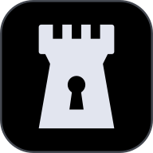

# CypherArx GUI



[日本語版はこちら / Japanese version](README.ja.md)

Desktop GUI for **CypherArx**, built on top of `cypherarx-core` and drawn with
[lamina-ui](https://github.com/Capsicum0907/lamina-ui) (Material 3 Expressive on SDL3 + ThorVG).

> **Status: pre-alpha.** It has not been reviewed by anyone else, and the vault format may
> change without notice. **Do not keep real passwords in it yet.**

This is Phase 2: the first part of CypherArx with a user interface. The UI-free core lives in
`cypherarx-core` and is included here as a git submodule under `external/cypherarx-core`. The
GUI is plain C++ that links the core directly, so secrets never cross a language boundary and
the core's guarded memory (`Secret`) is used as-is.

An earlier Dear ImGui front end lived here until 2026-11; it is in the git history.

## Toolchain

MSVC (Visual Studio 2022) + CMake + Ninja + vcpkg (manifest mode), the same toolchain as
`cypherarx-core`. Dependencies come from vcpkg: `libsodium` and `sqlite3` for the core, and
`abseil`, `harfbuzz`, `sdl3`, `thorvg` for lamina-ui. lamina-ui itself is a git submodule under
`external/lamina-ui`.

## Build

Requires a C++23 compiler, CMake >= 3.25, Ninja, vcpkg (`VCPKG_ROOT` set) and Python 3.
Configure from a Visual Studio developer shell so `cl` is on `PATH`. After cloning, fetch the
submodules:

```sh
git submodule update --init --recursive
python -m pip install -r external/lamina-ui/tools/icon-subset/requirements.txt
cmake --preset release
cmake --build --preset release
```

There are two presets. `release` builds the executable to use, optimized, in
`build-release/`. `default` builds an unoptimized Debug executable in `build/`, for the smoke
test and for debugging, where the runtime checks of the Debug libraries are on. **Do not
judge the speed by the Debug build.** lamina-ui draws every pixel on the CPU (the GPU only
shows the finished frame, so it stays near 0 %), and a Debug configuration also links the
unoptimized builds of ThorVG and the other dependencies; opening a sheet then pins a core
and stutters, while the Release build is smooth.

Python is for the icons. The Material Symbols the GUI uses are listed under
`lamina_add_resources` in `CMakeLists.txt`; the build cuts them out of the font that lamina-ui
vendors (with fontTools and brotli, which the `pip` line installs) and compiles them into the
executable, so it needs no asset folder.

Run `build-release/cypherarx_gui`, or a headless smoke test with no window:

```sh
./build-release/cypherarx_gui --selftest
```

The smoke test drives the model layer in `src/model/`: it creates a vault, adds a service, a
persona and accounts, checks both axes, the search and the rules for the kinds of entry, adds a
field, copies it, and checks that closing the vault clears the clipboard.

## CI

`.github/workflows/ci.yml` builds on `windows-latest` with MSVC + vcpkg and runs `--selftest`,
once normally and once with MSVC AddressSanitizer (`/fsanitize=address`, RelWithDebInfo). The
submodules are fetched over HTTPS and the checkout uses no secret.

## Layout

```
src/strings.hpp                  every UI string

src/model/session.{hpp,cpp}      the application without a toolkit: vault, selection, filters, entry/field/category/tag/login-method operations, TOTP, the rules for the kinds of entry
src/model/preferences.{hpp,cpp}  the preferences file outside the vault: load and save
src/model/projection.{hpp,cpp}   builds the entry tree for one axis (service / persona), applies the search/category/tag filter
src/model/timed_clipboard.*      timed clipboard clearing behind a small clipboard interface
src/model/secret_buffer.hpp      fixed-size text buffer in guarded memory, for password / secret value inputs

src/platform/file_dialog*        native open/save dialogs

src/lamina_gui/config.hpp        every tunable value (window, themes, the preferences file, sizes, icons, clipboard, KDF preset, buffer sizes)
src/lamina_gui/controls.*        one control interface, a panel that routes input and focus, wrappers around lamina-ui widgets, tooltips
src/lamina_gui/list_view.*       scrolling list / tree / table rows with actions on the row
src/lamina_gui/select_field.*    drop-down selection
src/lamina_gui/secret_field.*    text input that keeps its value in guarded memory, masked or shown
src/lamina_gui/sheet.*           modal sheets with form content, and lamina-ui dialogs and menus as modals
src/lamina_gui/sheets.*          the password, entry, field, organize and login-method sheets
src/lamina_gui/app.*             the three-pane window, input routing, the frame loop
src/lamina_gui/main.cpp          entry point, --selftest

resources/windows/app.{ico,rc}   the application icon, embedded in the executable on Windows
resources/app-icon.argb          the same icon as pixels, drawn at the left of the title bar
resources/icon.{svg,-512.png}    the same icon as a vector drawing and as a large image
tools/app-icon/make_icon.py      draws that icon (Python 3 with Pillow)
```

Colours, sizes, the clipboard timeout and the Argon2id preset are all in `config.hpp`; nothing
of that kind is written inline in the drawing code. UI text lives in `strings.hpp` for the same
reason (and to make a later translation a single-file change).

The application icon is a placeholder: a tower with a keyhole, in the two colours of the default theme
(its background and its text). It is drawn at three levels of detail: four merlons and a
small keyhole from 48 px up, three merlons and a larger keyhole at 40 px, and versions
placed pixel by pixel at 16, 20, 24 and 32 px. The title bar shows the 20 px one as it is,
without scaling, so it is sharp at 100% display scaling and soft above that. It is drawn by a
script, and `app.ico` and
`app-icon.argb` are its committed outputs, so a build does not need Pillow. **It resembles
the logo of an existing password manager (a rook with a keyhole), so it is to be replaced,
and it has not been checked against registered trademarks.**
The shapes and colours are the constants at the top of the script. To draw it again:

```
python tools/app-icon/make_icon.py --ico resources/windows/app.ico --pixels resources/app-icon.argb \n    --svg resources/icon.svg --png resources/icon-512.png
```

The taskbar takes the icon from the executable. The title bar is drawn by lamina-ui, whose
title bar has no place for an icon, so the application leaves lamina-ui's title empty and
draws the icon and the title itself over the bar. `app-icon.argb` is the width and the
height as two little-endian 32-bit integers, then the pixels row by row as ARGB with
straight alpha, which is what `lamina::render::Image` holds; it is embedded with
`lamina_add_resources`. The icon's size and its gap to the title are in `WindowConfig`.

## What the GUI does today

- Create / open a vault (`*.cax`) with a master password. The password is typed into guarded
  memory and wiped after key derivation, which runs on a worker thread behind a spinner.
  The path of the vault opened last is saved, and the next start asks for its password
  straight away; Cancel leaves the window with no vault open. If that file is not there, the
  status line says so and the saved path is kept. A vault in an older format is brought up
  to the current one when it is opened with the right password (the core's format version);
  after that, an older build of CypherArx can no longer use it. A vault in a newer format is
  refused with a message and is not changed.
- Three columns: a **sidebar** that chooses what to look at, the **entry tree** with a tab for
  each axis and a search box, and the **fields** pane for the selected entry.
- Entry tree with two views of the same data: **Service axis** (tree by `parent_id`) and
  **Persona axis** (tree by `persona_id`). An account appears in both; the third column shows
  its parent on the other axis. The model is in the core's `docs/data-model.md`. On the persona axis the
  accounts under a persona, and the accounts without one, are ordered by their service and
  then by their own name, so the accounts of one service stay together; the service axis
  keeps the order of creation. The tree starts with every row closed. Opening and closing is
  remembered until the vault is closed, and the rows above a newly selected entry open so
  that it can be seen. While the search or a place in the sidebar narrows the tree, the rows
  that are left are shown open instead, since what was looked for is inside them.
- A service's name, its URLs and its login URL are separate. The name is optional. The URLs
  are fields of the type `url` on the service (a service takes no other kind of field), any
  number of them, and none for something with no site. A service without a name is shown by
  its first URL, in the tree, in the other axis's column and in the selection lists, and the
  search looks at that URL too. The field types an entry takes are `Session::field_types`.
- Setting a persona for several accounts: every account row in the entry tree has a
  checkbox, and only account rows do, so a service or a persona cannot be caught up in the
  change. Ticking does not move the selection, and the ticks stay while other rows are
  looked at. The button before it ticks every account in the current view (the place chosen
  in the sidebar and the search), and unticks them all while they are all ticked. The *Set
  Persona* button next to the organize button opens the personas, with
  *(none)* first; after a confirmation that names the persona and the number of accounts,
  the ticked accounts get it and the ticks are cleared. It is how imported accounts, which
  arrive without a persona unless one was chosen at import, are sorted into personas. The
  ticks are in the model (`Session::marked`); the list draws a checkbox for a row that has a
  `check` value and reports a click on it.
- Merging services: a service's row has a *Merge Into Another Service* action. It asks which
  service to merge into; that one keeps its name, takes this one's accounts and URLs, and
  this one is removed. It is for services that turned out to be the same, such as one made
  by hand and one made by an import.
- The sidebar picks one place at a time: all entries, the favorites, one category (with its
  sub-categories) or one tag, so only one of its rows is ever highlighted. Search (name /
  display name / URL, ASCII case-insensitive) narrows that further. Matching entries keep their
  ancestors and descendants in the tree; ancestors that do not match themselves are dimmed.
- Add / edit / delete entries. Add opens a menu of what to add (Service, Persona, Account,
  Child). An account picks its service and (optionally) persona; a child picks its parent
  account. An account cannot be created before a service exists, and a child cannot be created
  before an account exists.
- The four kinds of entry are treated by their role, not all alike. Only a service has a
  category. Fields belong to accounts and children: on a service or a persona Add is disabled
  and the pane says so, though fields that already exist there can still be edited and deleted.
  An account's name is optional; left empty, its row and title show its parent on the other
  axis, the service on the persona axis and the persona on the service axis. These rules live in
  `Session::traits`.
- What acts on one entry or one field sits on its row. Hovering a row, or moving to it with the
  keyboard, shows icon buttons at its right end: login methods (accounts only), edit and delete
  on an entry; copy, TOTP (`totp` fields only), edit and delete on a field. Icon buttons show a
  tooltip after a short hover.
- Organize sheet: categories (presets are read-only; custom ones can be nested, renamed,
  deleted) and tags (rename, delete). Category and tag names are encrypted at rest.
- Fields are `text` / `password` / `totp`. The value is edited in guarded memory; `password`
  values are masked with a Show toggle and a Generate button.
- Copying a field value: the clipboard is cleared automatically after the configured delay if
  it still holds that value, and also when the window closes.
- TOTP: the code with a countdown ring, updated once a second; the decoded key is wiped when
  the panel is closed.
- Login methods (the reference-link layer): per account, add / edit / delete how you log in,
  with "via" limited to accounts on a *different* service (self-reference is structurally
  impossible).
- Delete operations ask for confirmation, default No, and are soft deletes in the core.
- Keyboard: Tab moves between controls; in the entry tree and the field list the arrows move
  the selection, Left and Right collapse and expand, Enter opens the edit sheet and Delete
  deletes. A double click opens the edit sheet too; on an entry that has children it collapses
  or expands it instead. `Ctrl+F` focuses the search box.
- Themes: the palette button opens a menu of *Dark, outlined* (black ground, panes drawn as
  outlines, one filled button), *Dark, tonal* (neutral greys, panes as raised surfaces) and
  *Light*. A theme is one `ThemePreset` in `config.hpp`: the scheme variant, the colour roles
  of the ground, the panes, the sheets and the popups, whether panes are filled or outlined,
  and the kinds of the main buttons. Every theme is built from the same seed colour. The
  choice is saved and the window starts with it next time.
- Preferences: the theme has to be known before any vault is open, so it cannot live in the
  vault's encrypted settings. It is kept in `preferences.conf` in the system's per-user
  application data directory (`%APPDATA%\CypherArx\CypherArx` on Windows), as plain
  `key = value` lines: `theme` holds the `id` of a `ThemePreset` and `vault` the path of the
  vault opened last (one path, no history). The path is not treated as a secret: whoever can
  read this file can also search the disk for vault files.
  The file is replaced through a temporary file. A missing file means the defaults; a theme
  this version does not know falls back to the first theme and says so in the status line,
  as does a failed save. **Only what has to be known before a vault is open, and is not
  secret, belongs in this file.** Everything else stays in the vault, encrypted.
- Vault menu (the gear button, with a vault open):
  - *Vault settings*: the values the core keeps encrypted in the vault (access log
    retention, session length, idle lock, OS keyring, lock on screensaver, password before
    an export). The access log retention, the idle lock and the lock on the screensaver
    take effect; the session length, the keyring and the export settings do not yet, and
    the sheet says so. The session length is how long a session kept in the OS keyring
    lasts after the application is closed, so it has nothing to act
    on until the keyring is there; it does not close a vault that is open.
- Locking: the vault closes by itself after the idle time without pointer, wheel, key or
  text input (0 turns this off). Open sheets are cancelled, which wipes what was typed into
  them, the status line says why, and the password sheet for the same vault opens. A running
  key rotation is not interrupted. The time is the vault's setting, so the default (10
  minutes) applies to a vault that never changed it. The rule is in the model
  (`Session::lock_if_due`, which takes the time, so the smoke test checks it without
  waiting); the window reports input and wakes itself when a lock is next due. With the
  *lock on screensaver* setting on (the default), the vault also closes when the
  screensaver starts, the screen is locked, the user is switched or the session is
  disconnected, and when the computer wakes up from sleep. `platform/away.hpp` reads these from
  the OS (Windows: the screensaver flag, the session state and the resume notification),
  the window asks it every two seconds while a vault with the setting is open, and the
  model decides (`Session::lock_for`). Only the model's part is covered by the smoke test.
  - *Import File*: reads an export into guarded memory: a browser's or a password
    manager's CSV, the XML that KeePass exports, or a 1Password 1PUX archive. The format is
    told from the file's first bytes, not from its name (the core's `import_format`). It
    adds one service per site, found by any of its URLs or made with the site as its URL
    field and the row's URL as its login URL, and one account per login, whose fields are the user name
    (*Email* or *ID* by its shape), the password and the TOTP secret. After the file is chosen a sheet asks for a persona; every
    account in the file gets it, and accounts already in the vault are not changed. Importing the same file again
    adds nothing. The sheet also has a checkbox, off by default, to delete the file after a
    successful import: the file is then overwritten with zeros and removed (the core's
    `erase_file`; it does not go to the recycle bin, and what the overwrite cannot reach is
    listed in the core's README), and the result says so. Without the checkbox the result
    is shown with a reminder that the file still holds every password as plain text. A
    failed import leaves the file untouched either way. What each format gives and leaves
    out (the history and the recycle bin of KeePass, the attachments of 1Password) is in
    the core's README. The file is read whole, and both the file and the unpacked data of
    a 1PUX archive must fit in 16 MiB each, so an archive with large attachments is
    refused as too large. **The XML and 1PUX paths have been tried on screen with files
    made after the formats, not with files exported by KeePass or 1Password.**
  - *Rotate key*: after a confirmation and the master password, every stored value is
    encrypted again with a new data key, on a worker thread behind the spinner.
  - *Change master password*: a sheet asks for the current password and the new one twice.
    The change also replaces the data key and encrypts every stored value again (the core
    has no way to change the password and keep the key), on the same worker thread.
- A new master password, in *Change master password* and in *New Vault* (which uses the
  same sheet without the current password): it is typed twice and cannot be pasted in. A
  line under the field says how strong it is as it is typed, and in a change how it
  compares with the current one. Under 12 characters, or easy to guess, it is refused;
  a fair one, or one weaker than the current one, needs a confirmation.
  The judgement is the core's `master_password_strength`; the wording and
  the comparison are in the model (`judge_password`). Opening an existing vault is not
  affected, whatever its password.
- Key strength, in the same sheet: when the sheet opens, the core's `benchmark_kdf` measures
  this computer on a worker thread, once per run of the application (about four seconds),
  and the *Key strength* field then offers *Light*, *Standard* (the default) and *Strong*
  with the seconds each takes to open the vault here and, once a password is typed, a
  power-of-ten number of years to guess it. The years assume one
  computer like this one and the password estimate above, so they are a scale, not a
  promise, and the sheet says so. The Argon2id numbers themselves are not shown. *OK* is
  refused until the measurement is done. If the measurement fails, all three are the fixed
  parameters used before.
- Access log: copying a field value or a TOTP code, and showing a TOTP code, is recorded in
  the vault (encrypted), and records past the retention are removed when the vault is
  opened. The sidebar's *Recently used* shows the entries with a record inside the
  retention, in the tree with their parents, and the line under a selected entry's name says
  how many times it was used in that time. With a retention of 0 nothing is recorded and the
  view is empty. There is no ranking by use.

Not yet: session continuation via the OS keyring, in-app browser, favicons, import.

## How it is put together

The logic lives in `src/model/` and knows nothing about the toolkit; it reports failures as
messages instead of opening dialogs. `src/lamina_gui/` only turns it into controls.

Colour roles, type scale, corner sizes and springs all come from lamina-ui's tokens. The window
uses lamina-ui's client-drawn title bar (`WindowConfig::client_title_bar`; with it off, or where
lamina-ui cannot draw one, the window keeps the system frame). The window only repaints on input
or while something moves, and wakes itself for the caret blink, the tooltips, the TOTP countdown
and the clipboard deadline.

Buttons, icon buttons, checkboxes, text fields, labels, the progress ring, the scroll area,
focus order, tabs, menus and the confirm / message dialogs are lamina-ui widgets. lamina-ui has no
list, tree, drop-down, masked input, tooltip or dialog with custom content yet, so those are
written here on top of lamina-ui's canvas, text layout and tokens:

- `ListView`: rows with columns, sections, indentation, expand / collapse and actions on the
  row. It serves the sidebar, the entry tree, the field list, the lists in the sheets and the
  drop-down's popup.
- `SelectField`: an outlined field that opens a scrolling popup, so long lists fit the window.
- `SecretField`: the master password and field values never leave guarded memory
  (`SecretBuffer`); masked input draws dots and does not lay the text out at all. It moves the
  caret (arrows, Home, End, click), deletes and pastes, but has no selection, copy or cut.
  lamina-ui's own text field, used for labels, notes and search, has all of them, with undo.
- `Sheet`: a modal surface that holds a form.
- `HoverTip` and `paint_tooltip`: the tooltip of the icon buttons and of the row actions.

Tag chips in the entry sheet take the pointer only.

## Design

The design (purpose and principles, cryptography, data model) is in the core's `docs/`:
`external/cypherarx-core/docs/design.md` and the documents it lists.

## License

cypherarx-gui is licensed under the [Apache License 2.0](LICENSE). See [NOTICE](NOTICE).
NOTICE lists the libraries it is built with and their licenses.
